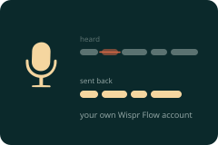

  

# Wispr Transcriber

  

Didn't work? Create a Studio workspace and paste this to your agent:
` /use-template https://github.com/boweiliu/wispr-transcriber-template`

## Why you care

Turn speech into text through your own Wispr Flow account, with no official API: drop-in HTTP/OpenAI speech-to-text for phone or web apps plus a recorder page.

Wispr Flow turns messy speech into punctuated, clean writing -- stripping "um"s and
fixing numbers and punctuation. Their official API is closed to new partners. This gives
your workspace that same transcription using **your own Wispr Flow account**, as an
always-on local speech-to-text service any app in your workspace can call (including a
writing or notes app you open in Safari on your phone).

Nothing on your Mac is modified or installed -- no patching, no re-signing, no Terminal
script. Just one read-only folder share.

## How to use it

1. **Approve one read-only folder share on your Mac.** Your agent requests read-only
   access to `~/Library/Application Support/Wispr Flow` (with synced copy turned on).
   One click in Imbue Studio -- no helper to install on your Mac.
2. **Use it from the recorder page or wire it into any app.** Open the Wispr Transcriber
   page to dictate and test, or have your agent point any existing app's speech-to-text
   button at `http://127.0.0.1:8122/api/transcribe` (or the OpenAI Whisper-compatible
   `http://127.0.0.1:8122/v1/audio/transcriptions`).

You need a Mac with Wispr Flow installed and signed in. After that one approval,
transcribing does not need your Mac awake at all; Wispr Flow only needs to have run on
your Mac within the last ~5 days so its own token stays fresh.

## Ideas for making it yours

- **Replace Safari speech-to-text in a phone writing app.** Record with `MediaRecorder`
  (`audio/mp4` on iOS Safari), POST to your app's own backend, and forward to
  `http://127.0.0.1:8122/api/transcribe` or `/v1/audio/transcriptions` for punctuated,
  Wispr-quality text.
- **Transcribe a pile of voice memos at once.** `wispr-transcribe <file>` handles `.m4a`,
  `.mp3`, `.webm`, `.wav`, and anything else ffmpeg reads.
- **Send your own vocabulary.** The desktop app passes your personal dictionary along with
  the audio and this client does not yet; the fields are already in the included `.proto`,
  ready to fill from `config.json`.
- **Keep a searchable dictation archive.** Every run already saves its audio and Wispr's
  full unprocessed reply under `data/.apps/wispr-transcriber/runs/`.

## What this is

This repository is a published **Imbue Studio template**: a clean, bootable
snapshot of what an agent built, ready to adapt into your own. It is NOT the
generic workspace template -- it is this specific project.

[`template.md`](template.md) is the full manifest -- what it is, how it
works, what it needs to run, and what to adapt -- with the
machine-readable half (recipe, requirements, and the environment it needs
installed) in [`template.toml`](template.toml).
